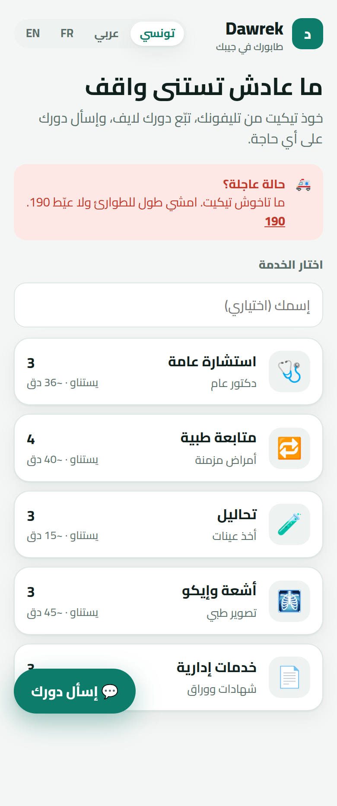
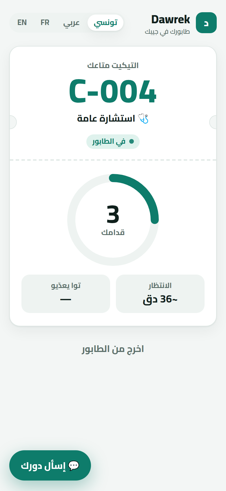
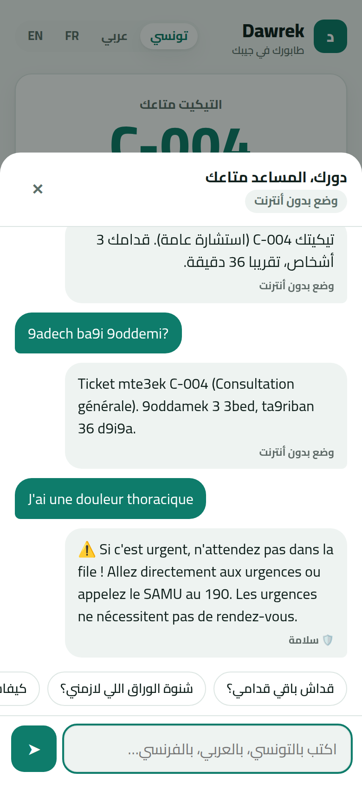
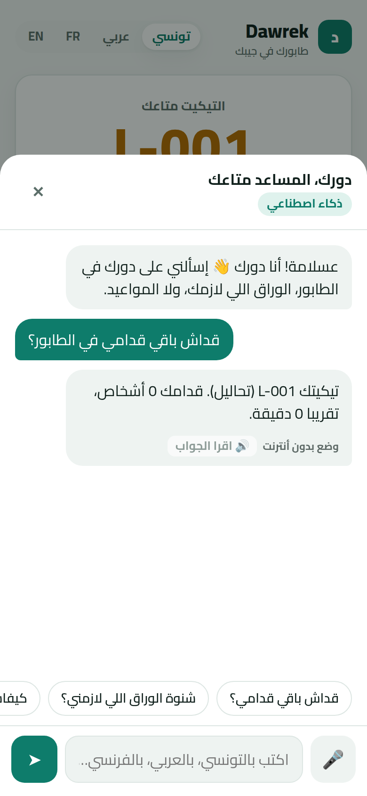
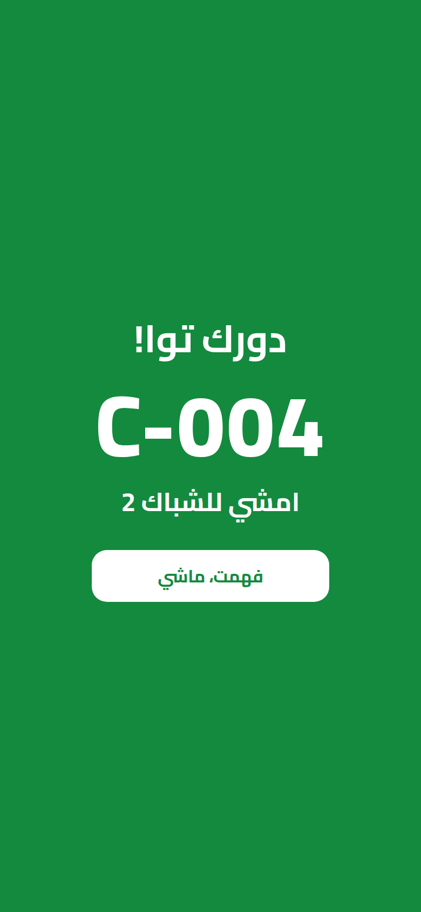
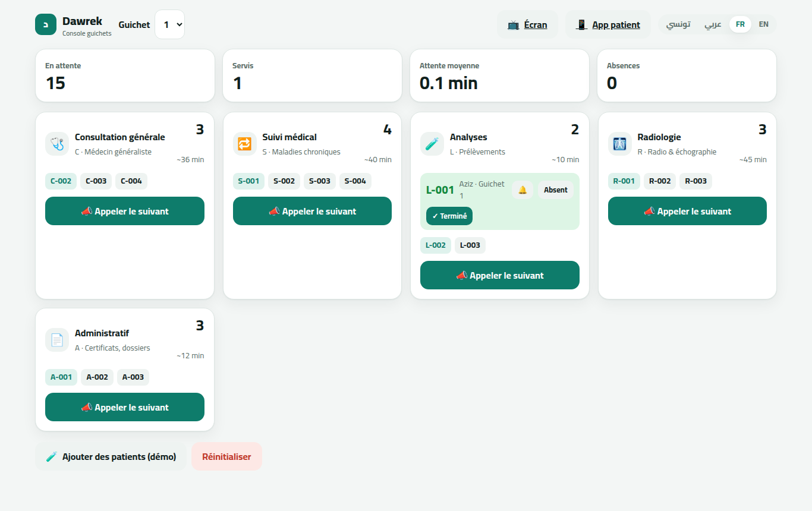
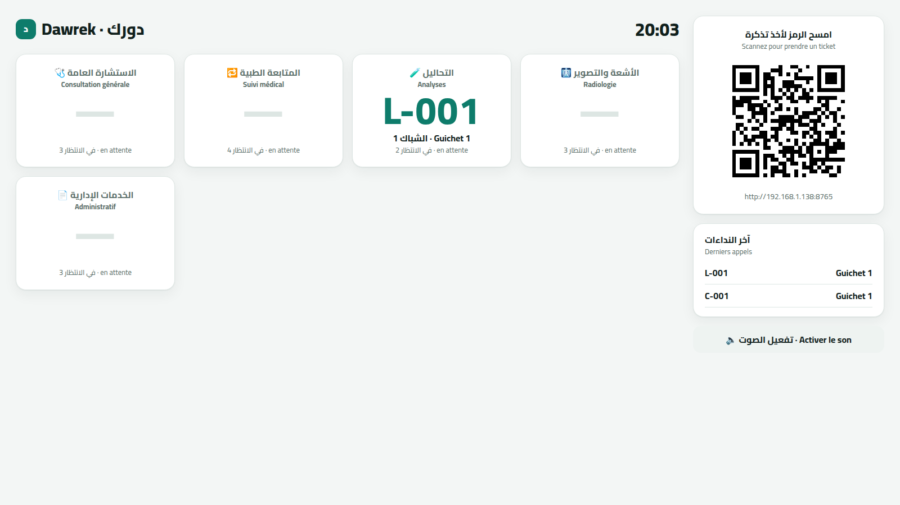
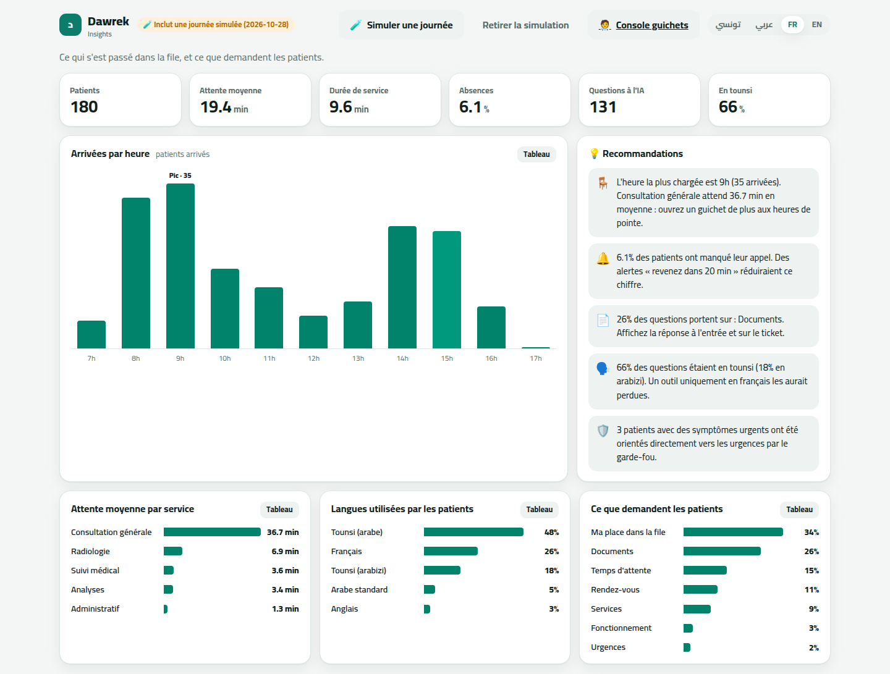

# Dawrek · دورك

**Your clinic queue, in your pocket.** Patients take a ticket from their phone, follow their turn live,
and ask an AI assistant anything in **Tunisian Darija** (Arabic *or* Latin script), Arabic, French or English.

> *Dawrek* means "your turn" in Tunisian.

| Patient app | Live ticket | AI assistant | Voice question | Your turn! |
|---|---|---|---|---|
|  |  |  |  |  |

| Staff console | Waiting-room screen |
|---|---|
|  |  |

| Manager insights |
|---|
|  |

---

## The problem

In Tunisian clinics, hospitals and CNAM offices, patients wait **standing for hours** in crowded rooms,
afraid to step out and lose their place. They don't know how long it will take, which papers to bring,
or whether they're even in the right line. Reception staff answer the same questions all day.

## The solution

| | |
|---|---|
| 📱 **Take a ticket from your phone** | Scan the QR code on the waiting-room screen. No app to install, no account. |
| ⏱️ **Follow your turn live** | People ahead, estimated wait, who's being served. Grab a coffee and come back. |
| 🔔 **Get called** | Your phone turns green, rings and vibrates: *"Your turn, desk 2"*. |
| 💬 **Ask in your own words** | *"قداش باقي قدامي؟"*, *"9adech ba9i?"*, *"Quels papiers apporter ?"*. The assistant knows **your** live ticket. |
| 🎙️ **Just speak** | Tap the mic and ask out loud, in Darija or French. Dawrek transcribes it (Whisper) and can read the answer back. Made for elderly and low-literacy patients. |
| 🛡️ **Safe by design** | Urgent symptoms (chest pain, bleeding, can't breathe…) skip the AI and send the patient straight to emergency / SAMU 190. |
| 🧑‍⚕️ **One-click staff console** | Call next, mark done or absent. Absent patients move to the back of the line automatically. |
| 📺 **Waiting-room screen** | Bilingual now-serving board with voice announcements and a join QR code. |
| 📊 **Manager insights** | Peak hours, waits per service, no-shows, which languages patients write in and what they ask, plus concrete advice like *"open one more consultation desk at 9h"*. |

### Why Dawrek is different

- **It speaks Tunisian.** Most tools stop at French and MSA. Dawrek understands Darija in Arabic script
  *and* Arabizi (`9adech`, `3andi`, `chnowa`), which is how most Tunisians actually text.
- **It knows the live queue.** The assistant doesn't just recite an FAQ: it answers with the patient's
  real position and wait time.
- **It turns questions into data.** Every question patients ask becomes a signal for the clinic: what's
  confusing, when it's crowded, which language people really use. That's what a clinic pays for.
- **It never breaks.** No API key or no internet? Dawrek answers from the same data in offline mode.

---

## Quick start

```bash
git clone https://github.com/Islem-rb/dawrek-ai && cd dawrek-ai
./run.sh
```

Then open:

| | URL |
|---|---|
| Patient app | http://localhost:8000 |
| Staff console | http://localhost:8000/staff |
| Waiting-room screen | http://localhost:8000/screen |
| Manager insights | http://localhost:8000/insights |

To turn on the AI, put a free key from [console.groq.com](https://console.groq.com/keys) in `.env`:

```
GROQ_API_KEY=gsk_...
```

Without a key everything still works; the assistant answers in offline mode (voice needs the key).

**Phones on the same Wi-Fi** can scan the QR code on `/screen` to join the queue. The microphone only works on
`localhost` or HTTPS, so for voice on phones use the public deployment below.

---

## 🌍 Put it online (free)

### Option A: share your laptop with a public link (no account)

A free [Cloudflare Quick Tunnel](https://developers.cloudflare.com/cloudflare-one/connections/connect-networks/do-more-with-tunnels/trycloudflare/)
gives the app on your laptop an HTTPS address that any phone can open over 4G, so you don't depend on the
venue's Wi-Fi. The laptop needs internet (a phone hotspot is fine).

```bash
./share.sh
```

It prints a `https://….trycloudflare.com` link. Open `/screen` on that link and the QR code points to it.
The link changes on every start and stops when you press Ctrl+C.

### Option B: Render (permanent URL)

[Render's free plan](https://render.com/docs/free) needs no credit card, but the service **sleeps after 15 min**
idle and takes about a minute to wake. Open it a minute before your demo.
Push the repo to GitHub, then in [Render](https://dashboard.render.com): **New → Blueprint →** pick the repo
(it reads `render.yaml`), and fill in `GROQ_API_KEY` and `STAFF_PIN`.

### Notes for a public demo

- **Staff PIN:** when `STAFF_PIN` is set, the staff console, reset and simulation ask for it once per device.
  Patients and the waiting-room screen never need it.
- **Free quota protection:** each visitor is limited to 15 chat messages, 8 voice questions and 10 tickets per minute.
- **State is in memory:** a restart or a sleeping instance starts with an empty queue. Press
  *Add patients (demo)* and *Simulate a day* before you present.

---

## 🎤 Demo script (3–4 minutes)

**Setup:** laptop shows `/screen` (projector) and `/staff` side by side. Click **🔈 Activer le son** on the screen.
Click **🧪 Add patients (demo)** once so the queue looks busy.

1. **The pain (20 s).** *"Every Tunisian has stood for hours in a clinic, not knowing when their turn comes.
   Dawrek fixes that."*
2. **Join (30 s).** Scan the QR code with your phone (or ask someone in the audience to). Pick
   *Consultation générale*. The ticket appears with people ahead and estimated wait.
3. **Ask in Tunisian (40 s).** Open **💬 إسأل دورك** and tap *قداش باقي قدامي؟*. Then type
   `chnowa lezmni njib?` in Arabizi. The answer comes back in the same style.
   Then tap **🎤** and *say* "شنوة الوراق اللي لازمني؟". *"My grandmother can use this."*
4. **Safety (20 s).** Type *"J'ai une douleur thoracique"*. Dawrek immediately redirects to emergency / 190.
   *"The AI is never trusted with emergencies."*
5. **Staff side (40 s).** On `/staff`, press **📣 Call next** a few times. The screen announces each number
   out loud, and the phone's ring shrinks live.
6. **Your turn (20 s).** When the phone's ticket is called, it turns green, rings and vibrates:
   *"Your turn, desk 1."* That's the moment that sells it.
7. **The business (30 s).** Open `/insights` and click **🧪 Simulate a day**. *"Here's a full clinic day:
   consultation is the bottleneck at 9h, a quarter of the questions are about documents, and two thirds are
   in Tunisian. Dawrek tells the manager exactly what to fix."*
8. **Close (10 s).** *"No hardware, no app install, works in Darija. Any clinic can start tomorrow."*

---

## How it works

```
 Phone (patient)          Staff console           Waiting-room screen
       │                        │                          │
       └──────────── FastAPI (backend/main.py) ────────────┘
                     │                     │
          Queue engine                Assistant
     (backend/queue_engine.py)    (backend/assistant.py)
     tickets · positions · ETA    1. detect language (tn / arabizi / ar / fr / en)
     desks · no-shows             2. emergency guardrail → fixed answer
                                  3. context = live ticket + knowledge base
                                  4. Groq gpt-oss-120b → or offline fallback
                                             │
                                  data/knowledge_base/*.txt
                                  (each topic in MSA, Darija, French)
```

- **Backend:** Python, FastAPI. The queue lives in memory, which suits demos; swap `QueueEngine` for a database in production.
- **Voice:** the browser records the question, Groq Whisper (`whisper-large-v3`) transcribes it with a
  Darija vocabulary hint, and the text goes through the normal chat flow. Answers are read aloud by the
  browser's built-in speech (free, no server cost).
- **AI:** Groq (`openai/gpt-oss-120b`, configurable via `GROQ_MODEL`). The knowledge base is small,
  so it goes straight into the prompt in the patient's language. No vector database needed.
- **Frontend:** plain HTML/CSS/JS, no build step. Mobile-first, RTL-aware, light and dark mode.
- **Live updates:** the pages poll the API every 1.5–2 s.
- **Insights** (`backend/insights.py`): computed from real tickets and chat questions. *Simulate a day* adds
  one realistic past day (a small queue simulation using the 8–10h / 14–16h peaks from the knowledge base),
  always labeled as simulated on the dashboard.

### Edit the clinic's information

Each file in `data/knowledge_base/` is one topic with three sections (`--- ARABIC (Modern Standard) ---`,
`--- TUNISIAN DARIJA ---`, `--- FRENCH ---`). Edit the text and restart. Service names and average
durations live in `SERVICES` in `backend/queue_engine.py`.

### API

| Method | Path | |
|---|---|---|
| `POST` | `/api/tickets` | take a ticket `{service, name?}` |
| `GET` | `/api/tickets/{id}` | live status, position, ETA |
| `DELETE` | `/api/tickets/{id}` | leave the queue |
| `POST` | `/api/transcribe` | raw audio body (webm / ogg / mp4) → `{text}` |
| `POST` | `/api/chat` | `{message, ticket_id?, history?}` → `{reply, lang, mode}` |
| `GET` | `/api/queue` | full board for staff & screen |
| `POST` | `/api/staff/call` | `{service, desk}` call next |
| `POST` | `/api/staff/tickets/{id}/done` · `/no-show` · `/recall` | desk actions |
| `GET` | `/api/insights` | KPIs, arrivals by hour, waits, languages, topics, recommendations |
| `POST` · `DELETE` | `/api/insights/simulate` | add / remove a simulated past clinic day |

Interactive docs at http://localhost:8000/docs.

### Tests

```bash
pip install -r requirements-dev.txt
pytest
```

---

## Roadmap

- **SMS / WhatsApp alerts** for patients without a smartphone, or who leave the building.
- **Appointment booking** with priority in the line (appointment holders wait ~60% less).
- **Staff login and multi-clinic** support with a real database.
- **Insights over weeks and months**, with exports and comparison between clinics.
- **Smarter ETA** learned from real service durations instead of fixed averages.
